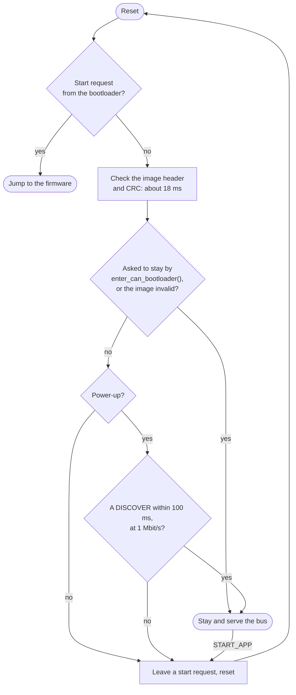
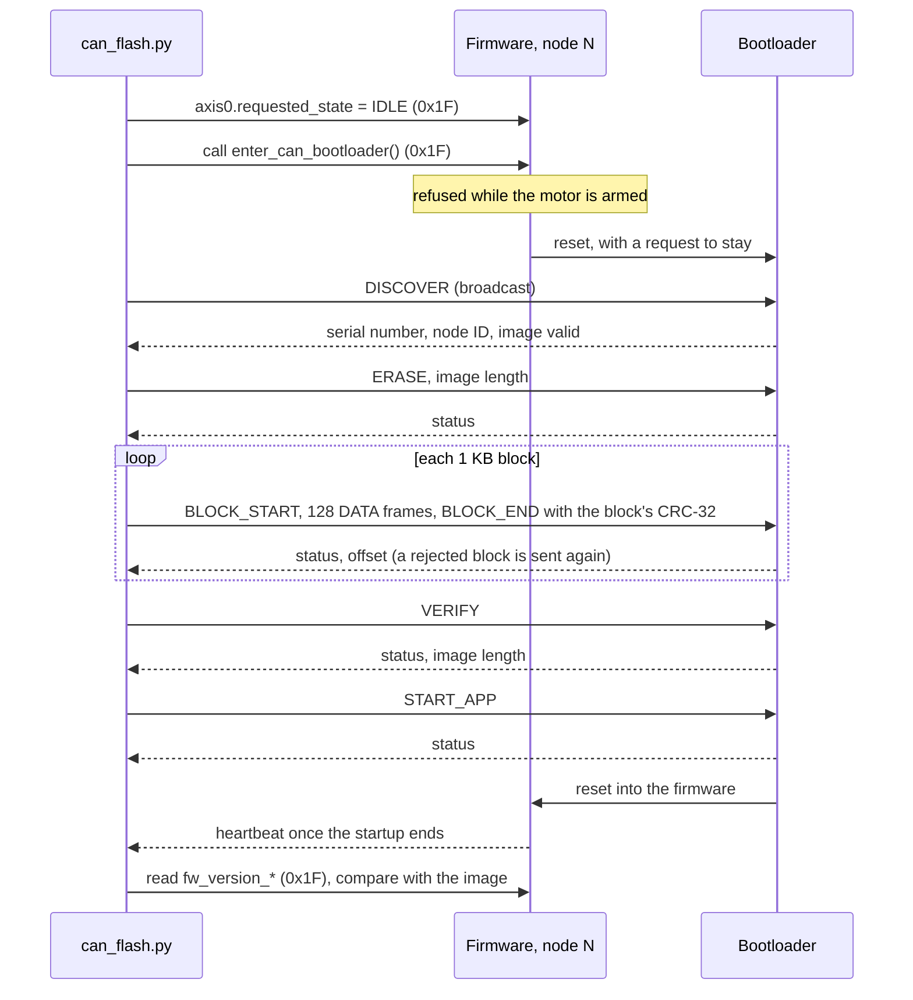

# CAN bootloader

A board with the CAN bootloader takes firmware updates over its CAN bus, so boards built into a machine update without USB or SWD. The STM32F405's built-in bootloader speaks CAN only on CAN2 (PB5 and PB13), not on the Mini's CAN1 pins (PB8 and PB9), so this firmware brings its own: a 4 KB program in the first two flash sectors. The built-in bootloader stays available: USB DFU (`tools/usb_flash.py`, or holding S2 through a reset) and SWD recover a board whatever its flash holds.

## Flash layout


The bootloader takes sectors 0-1 (32 KB) and is never written over CAN. The firmware has sectors 2-9 (736 KB), the config sectors 10-11 (256 KB), which no firmware update touches.

The build links the firmware at 0x08008000 and seals it (`tools/seal_image.py`): the image header gets the image's length, its CRC-32 and the firmware version. `build/firmware.elf`, `.bin` and `.hex` hold the same bytes. `build/bootloader.elf` is the bootloader, and `build/firmware-with-bootloader.bin` both together from 0x08000000.

## What the bootloader does at a reset

At every reset the bootloader decides between starting the firmware and staying to serve the bus:



The firmware always starts through a reset, so it begins from the state a reset leaves, with no peripheral the bootloader set up. A DISCOVER (or any other bootloader command addressed to the board) within the 100 ms window after a power-up holds a board in the bootloader even when its firmware is valid.

The gate driver stays off throughout: the motor is limp while the bootloader runs.

## Moving a board onto the bootloader (once, over USB)

```sh
make                                                   # builds the bootloader, the firmware and the combined image
python tools/usb_flash.py --bin build/firmware-with-bootloader.bin          # dry run: backup and compare
python tools/usb_flash.py --bin build/firmware-with-bootloader.bin --write  # writes the sectors the image covers; the config stays
```

From then on, `usb_flash.py --elf build/firmware.elf` and `can_flash.py` both replace only the firmware. `usb_flash.py` and `swd_flash.py` refuse to write firmware linked at 0x08008000 to a board without the bootloader, which would leave it unable to start. Flashing an image linked at 0x08000000, such as an older release or a backup's `flash.bin`, replaces the bootloader: the way back.

## Updating over CAN

```sh
python tools/can_flash.py --elf build/firmware.elf --node 1 --interface slcan --channel /dev/cu.usbmodemX           # dry run
python tools/can_flash.py --elf build/firmware.elf --node 1 --interface slcan --channel /dev/cu.usbmodemX --write
```

`can_flash.py` defaults to a candleLight adapter (`--interface gs_usb`); the example uses an slcan adapter on a serial port. `--node` reaches a board running its firmware. The update then runs as one exchange per step:



Frames to and from the firmware use CANSimple's 11-bit IDs; frames to and from the bootloader use its 29-bit IDs. A dry run (no `--write`) leaves out ERASE and the blocks, so it still takes the board into the bootloader and back. `--serial` reaches a board already in the bootloader: one whose firmware doesn't start, or one held there at power-up. The bootloader runs at the bit rate the firmware passed on, or at 1 Mbit/s after a power-up.

If an update stops partway, the board's image fails its CRC and the board waits in the bootloader: run `can_flash.py` again, with `--serial` (the serial number is in `can_flash.py`'s output and the logs).

## Protocol

29-bit CAN IDs, which CANSimple's 11-bit IDs never collide with; each carries the low 20 bits of the board's serial number, so boards in the bootloader never send the same ID. The commands are DISCOVER, ERASE, BLOCK_START, DATA, BLOCK_END, VERIFY and START_APP; `src/bootloader/boot_protocol.hpp` documents the frames, and `tools/xdrive/boot_frame.py` is the host codec.

The bootloader itself is updated only over USB or SWD, so a failed update never touches the part that recovers a board over CAN.
