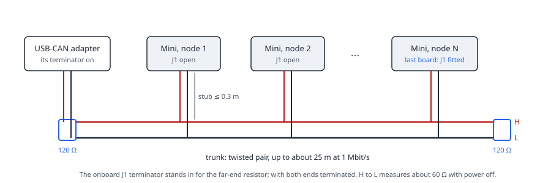
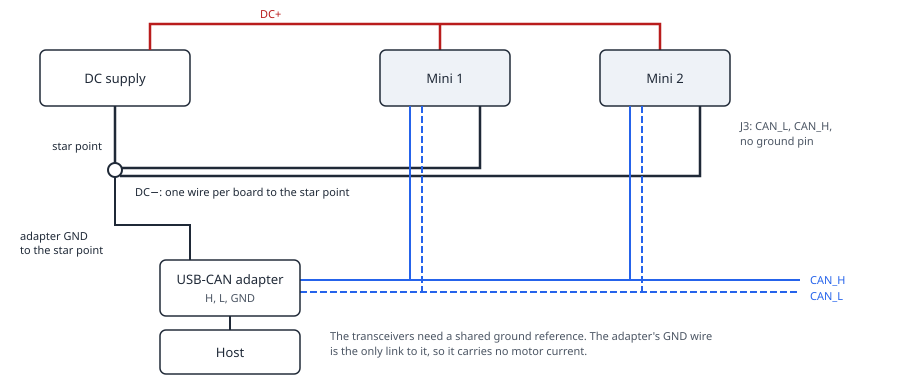

# CAN

Each Mini is one node on a CAN bus, speaking ODrive's CANSimple protocol plus two messages of this firmware's: the impedance command (0x1E), which sends a full setpoint and gets the joint's state back in one frame pair, and endpoint access (0x1F), which reads and writes any setting and calls any function, so a board can be configured, tuned and saved without USB.

> **Status:** the impedance and endpoint frames are tested on the host against the firmware's headers (`make test`), and impedance control is tested over USB. Neither has crossed a real bus yet, so the Python examples below are untested. `tools/can_test.py` is the bench test for one board on a bus ([Testing](testing.md)).

## Wiring



- **Connector J3** (JST-GH 1.25 mm, 2-pin): pin 1 CAN_L, pin 2 CAN_H. The transceiver is an SN65HVD232 (3.3 V).
- **One trunk with stubs.** Each board has one CAN connector, so boards tap off a twisted-pair trunk instead of daisy-chaining. At 1 Mbit/s, keep each stub (trunk to board) under about 0.3 m; the trunk can run to about 25 m.
- **Terminate both ends** of the trunk with 120 Ω: usually the host adapter's terminator at one end, and the onboard terminator of the last board at the other (fit jumper J1, which puts R18, 120 Ω, across the pair). Leave J1 open on every other board. With power off, CAN_H to CAN_L measures about 60 Ω when both ends are terminated (40 Ω: three terminators; 120 Ω: one).
- **Ground:** the transceivers need a shared ground reference, and J3 doesn't carry one. The boards' ground is the DC bus negative, so run the adapter's ground to the supply's negative at one point:



## Configure

1. `odrv0.can.config.baud_rate = 1000000` (default 250000).
2. `odrv0.axis0.config.can.node_id = <n>`: 0 to 63 with standard IDs, different on every board.
3. `odrv0.save_configuration()` (the board reboots).

CAN is on by default (`config.enable_can_a`, and GPIO15 and GPIO16 in `GPIO_MODE_CAN_A`). The [property reference](reference.md#odrv0axis0configcan) lists the cyclic message rates and the impedance ranges under `axis0.config.can`.

## Frames

A frame's 11-bit ID is `node_id << 5 | cmd`: node 1's Set Input Pos (0x0C) is `0x01 << 5 | 0x0C = 0x2C`. Lower IDs win arbitration, so a lower node ID and command number get the bus first. Payloads are little-endian, except the impedance frame's bit fields.

Every frame addressed to a board feeds its watchdog.

### Messages

"Host" messages are sent by the host; "board" messages by the board. Messages marked RTR are requests: the host sends the ID with the RTR bit set and no payload, and the board answers on the same ID.

| ID | Name | From | Payload (byte: field, type) |
|---|---|---|---|
| 0x001 | Heartbeat | board, cyclic | 0: axis error, uint32; 4: axis state, uint8; 5: motor error flag, 6: encoder error flag, 7 bit 0: controller error flag, 7 bit 7: trajectory done (bits) |
| 0x002 | Estop | host | none; sets `AXIS_ERROR_ESTOP_REQUESTED` |
| 0x003 | Get Motor Error | board, RTR or cyclic | 0: motor error, uint64 |
| 0x004 | Get Encoder Error | board, RTR or cyclic | 0: encoder error, uint32 |
| 0x005 | Get Sensorless Error | board, RTR or cyclic | 0: sensorless error, uint32 |
| 0x006 | Set Axis Node ID | host | 0: node ID, uint32 |
| 0x007 | Set Axis Requested State | host | 0: requested state, uint32 (8 = closed loop, 1 = idle) |
| 0x009 | Get Encoder Estimates | board, RTR or cyclic | 0: position [turn], float32; 4: velocity [turn/s], float32 |
| 0x00A | Get Encoder Count | board, RTR or cyclic | 0: shadow count, int32; 4: count in CPR, int32 |
| 0x00B | Set Controller Modes | host | 0: control mode, int32; 4: input mode, int32 |
| 0x00C | Set Input Pos | host | 0: position [turn], float32; 4: velocity feed-forward [0.001 turn/s], int16; 6: torque feed-forward [0.001 Nm], int16 |
| 0x00D | Set Input Vel | host | 0: velocity [turn/s], float32; 4: torque feed-forward [Nm], float32 |
| 0x00E | Set Input Torque | host | 0: torque [Nm], float32 |
| 0x00F | Set Limits | host | 0: velocity limit [turn/s], float32; 4: current limit [A], float32 |
| 0x010 | Start Anticogging | host | none |
| 0x011 | Set Traj Vel Limit | host | 0: [turn/s], float32 |
| 0x012 | Set Traj Accel Limits | host | 0: acceleration, 4: deceleration [turn/s²], float32 |
| 0x013 | Set Traj Inertia | host | 0: [Nm/(turn/s²)], float32 |
| 0x014 | Get Iq | board, RTR or cyclic | 0: Iq setpoint [A], 4: Iq measured [A], float32 |
| 0x015 | Get Sensorless Estimates | board, RTR or cyclic | 0: position, 4: velocity, float32 |
| 0x016 | Reboot | host | none |
| 0x017 | Get Bus Voltage and Current | board, RTR or cyclic | 0: voltage [V], 4: current [A], float32 |
| 0x018 | Clear Errors | host | none; clears every error on the board |
| 0x019 | Set Linear Count | host | 0: position [counts], int32 |
| 0x01A | Set Position Gain | host | 0: [(turn/s)/turn], float32 |
| 0x01B | Set Vel Gains | host | 0: velocity gain, 4: integrator gain, float32 |
| 0x01C | Get ADC Voltage | host, then board | 0: GPIO number, uint8 (sent without RTR); reply 0: voltage, float32 |
| 0x01D | Get Controller Error | board, RTR or cyclic | 0: controller error, uint32 |
| 0x01E | Impedance (added) | host, then board | see below |
| 0x01F | Endpoint access (added) | host, then board | see below |

IDs 0x000 and 0x700 are reserved for CANopen (NMT and heartbeat), which CANSimple doesn't implement; 0x008 (Set Axis Startup Config) is not implemented. The error and state values are in the [property reference](reference.md).

### Cyclic messages

The board sends these on a timer, per `axis0.config.can.*_rate_ms` (0 turns one off):

| ID | Message | Setting | Default [ms] |
|---|---|---|---|
| 0x001 | Heartbeat | `heartbeat_rate_ms` | 100 |
| 0x009 | Encoder Estimates | `encoder_rate_ms` | 10 |
| 0x003, 0x004, 0x005, 0x01D | Motor, encoder, sensorless and controller errors | `motor_error_rate_ms`, `encoder_error_rate_ms`, `sensorless_error_rate_ms`, `controller_error_rate_ms` | 0 |
| 0x00A | Encoder Count | `encoder_count_rate_ms` | 0 |
| 0x014 | Iq | `iq_rate_ms` | 0 |
| 0x015 | Sensorless Estimates | `sensorless_rate_ms` | 0 |
| 0x017 | Bus Voltage and Current | `bus_vi_rate_ms` | 0 |

## The impedance command (0x1E)

The host sends position, velocity, stiffness (kp), damping (kd) and feed-forward torque in one 8-byte frame. The board applies all five in the same control period and answers at once on the same ID with its position, velocity, measured torque, status flags, FET temperature and bus voltage. The control law is in [Control](control.md#impedance-control):

torque = kp × (position setpoint − position) + kd × (velocity setpoint − velocity) + feed-forward torque

**Before the first command:**

1. Set Controller Modes (0x00B): control mode 4 (`IMPEDANCE_CONTROL`), input mode 1 (`PASSTHROUGH`).
2. Set Axis Requested State (0x007): 8 (closed loop).

The command only sets the inputs; it doesn't change the mode or state.

**Layout.** Both frames are big-endian bit fields, the layout of the MIT Cheetah actuators (source: `src/communication/can/impedance_frame.hpp`):

| Frame | Bits 63–48 | 47–36 | 35–24 | 23–12 | 11–0 |
|---|---|---|---|---|---|
| Command | position, 16 | velocity, 12 | kp, 12 | kd, 12 | torque, 12 |

| Frame | Bits 63–48 | 47–36 | 35–24 | 23–16 | 15–8 | 7–0 |
|---|---|---|---|---|---|---|
| Reply | position, 16 | velocity, 12 | torque, 12 | flags, 8 | FET temperature [°C], 8 | bus voltage [0.25 V], 8 |

Signed fields map [−range, +range] to two's complement, with +range at 2^(bits−1) − 1; kp and kd map [0, max] to [0, 2^bits − 1]. Values beyond the range saturate. The ranges are settings on the board (`axis0.config.can.impedance_*`) and must match on the host:

| Field | Setting | Default | Resolution at the default |
|---|---|---|---|
| Position | `impedance_pos_range` | ±16 turn | 0.00049 turn (0.18°) |
| Velocity | `impedance_vel_range` | ±32 turn/s | 0.016 turn/s |
| kp | `impedance_kp_max` | 0 to 200 Nm/turn | 0.049 Nm/turn |
| kd | `impedance_kd_max` | 0 to 2 Nm/(turn/s) | 0.00049 Nm/(turn/s) |
| Torque | `impedance_torque_range` | ±4 Nm | 0.0020 Nm |

Reply flags: bit 0 armed (closed loop, motor armed), bit 1 any axis, motor, encoder or controller error, bit 2 watchdog hold active ([Safety and regen](safety-and-regen.md#watchdog-decelerate-and-hold)).

**From Python:** the [host library](python-library.md#can) does this for several joints per cycle (`bus.cycle()`). Without it, with [python-can](https://python-can.readthedocs.io) and the host codec `tools/xdrive/impedance_frame.py` (no I/O of its own):

```python
import can                 # python-can; run with tools/ on PYTHONPATH for xdrive
from xdrive.impedance_frame import Ranges, arbitration_id, decode_reply, encode_command

ranges = Ranges()          # must match the board's axis0.config.can.impedance_*
node = 1
with can.Bus(interface="socketcan", channel="can0", bitrate=1000000) as bus:
    bus.send(can.Message(arbitration_id=arbitration_id(node), is_extended_id=False,
                         data=encode_command(ranges, pos=0.25, kp=20.0, kd=0.3)))
    reply = bus.recv(timeout=0.01)
    if reply is not None and reply.arbitration_id == arbitration_id(node):
        state = decode_reply(ranges, reply.data)
        print(state.pos, state.vel, state.torque, state.armed, state.error)
```

The reply uses the command's ID, so a host commanding several joints collects one cycle's replies before it sends the next cycle.

## Endpoint access (0x1F)

The host reads or writes any property, or calls any function, by its endpoint ID: the `id` of the property in the board's interface JSON, the same table USB uses. It can also read the interface JSON itself and the [capture](capture.md) buffer. The board answers each request at once on the same ID. Source: `src/communication/can/endpoint_frame.hpp`; host codec: `tools/xdrive/endpoint_frame.py`.

| Bytes | Request | Reply |
|---|---|---|
| 0 | opcode: 1 read, 2 write, 3 call, 4 read buffer | the request's opcode + 0x80 |
| 1–2 | endpoint ID, uint16 | endpoint ID, echoed |
| 3 | 0 | status (below) |
| 4–7 | write: the new value; read buffer: byte offset, uint32; else 0 | read, write: the value after the request; read buffer: 4 bytes of the buffer; else 0 |

Values are the property's little-endian bytes, zero-padded to 4: a `float` is 4 bytes, a `uint16` 2, a `bool` 1. A write's reply carries the value read back after the write, so it shows what a property's setter stored.

| Status | Meaning |
|---|---|
| 0 | OK |
| 1 | No endpoint with this ID |
| 2 | Wrong kind: read or write of a function, call of a property, write of a read-only property, buffer read of a property |
| 3 | The property is wider than 4 bytes (`serial_number`, `motor.error`): out of reach over this message. Read `motor.error` with Get Motor Error (0x003) |
| 4 | A write's bytes past the property's size aren't zero (the host packed the wrong type); nothing was written |
| 5 | The board refused the request (a failed write, call or buffer read) |
| 6 | Unknown opcode |
| 7 | The request isn't 8 bytes, or is a remote frame |

**Functions.** A function's inputs and outputs are endpoints of their own, listed under the function in the JSON. Write the inputs, call the function, then read the outputs: `capture.add_channel` takes `capture.add_channel.endpoint_id` and leaves its result in `capture.add_channel.ok`. `save_configuration` and `reboot` reboot the board before it can reply; the heartbeat returns once it is up again.

**Buffers.** Opcode 4 reads 4 bytes at a byte offset:
- Endpoint 0 is the interface JSON (about 37 KB). Its bytes past the end read as zeros, and the JSON contains no zero byte. Offset 0xFFFFFFFF reads the JSON's version ID (uint32), which changes with every firmware build that changes the interface: a host caches the JSON per version ID and fetches it again only when the ID changes.
- Endpoint 0x7F00 is the capture readout (`capture.readout_endpoint`). Read `capture.state` first: the readout is all zeros until the capture is DONE.

**Each request is one frame pair**, so bulk reads are slow by USB standards. Estimated, not measured: at 1 Mbit/s and 0.13 ms per frame, the 37 KB JSON takes about 19,000 frames (about 2.5 s), and a full 32 KiB capture about 16,400 frames (about 2 s), more with the adapter's round-trip latency. Run bulk reads while the joints aren't being commanded.

Changes made this way are in RAM until `save_configuration` is called. Requests run in the board's CAN thread with the same handlers as USB, so a write over CAN has the same effect as the same write over USB.

**From Python**, with the [host library](python-library.md#can) (`tools/` on PYTHONPATH), which caches the interface JSON per version ID:

```python
from xdrive import can
from xdrive.props import odrv

with can.open(interface="socketcan", channel="can0", bitrate=1000000) as bus:
    board = bus.connect(1)
    print(board.set(odrv.axis0.controller.config.vel_gain, 0.05))   # the value read back after the write
    board.save()                                                    # stores the config; the board reboots
```

`tools/xdrive/can.py` is also the reference client for this message: request matching, timeouts and the reconnect after a reboot.

## Bus load

An 8-byte frame takes about 0.13 ms at 1 Mbit/s, including bit stuffing. For six joints, one impedance command and one reply each per cycle:

| Cycle rate | Frames per second | Bus load |
|---|---|---|
| 250 Hz | 3,000 | about 33 % |
| 500 Hz | 6,000 | about 67 % (too close to full) |

The default cyclic messages add 660 frames per second for six boards (heartbeat every 100 ms, encoder estimates every 10 ms), about 9 %. The impedance reply already carries position and velocity, so set `encoder_rate_ms = 0` when commanding with it.

## CAN database

`docs/cansimple.dbc` describes every message above for cantools, SavvyCAN and other DBC readers, once per node ID 0 to 7 (`Node3_Set_Input_Pos` is ID 3 << 5 | 0x00C). `make generate` writes it from `tools/gen_dbc.py`, and `make test` checks it against the host codec.

- **The impedance command** (`NodeN_Impedance`) is in it with scales for the default `impedance_*` ranges. A DBC holds one layout per ID, so the reply on the same ID isn't: decode replies with `tools/xdrive/impedance_frame.py`.
- **Endpoint access** (`NodeN_Endpoint`) is in it as the request (opcode, endpoint ID, value). Its reply, on the same ID, isn't: decode it with `tools/xdrive/endpoint_frame.py`.
- **Get messages** are defined as the board's reply. The host's request is a remote frame (RTR) with the same ID; `Get_ADC_Voltage`'s request carries the GPIO number in byte 0.
- `examples/can_dbc.py` (Motor moves) drives one board with python-can and the database: closed loop, a slow sine on `input_pos`, then IDLE.

## Other hosts

The ODriveArduino library's `ODriveCAN` speaks ODrive's v0.6 protocol. Against this firmware, which is based on v0.5.6, its heartbeat decoding and some commands differ; check each message against the table above.
