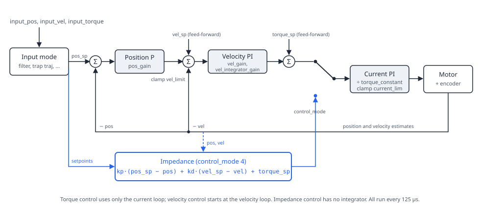
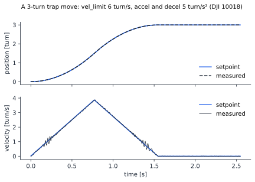
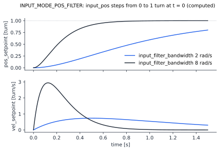
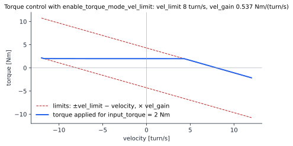

# Control

The controller is a cascade of position, velocity and current loops, as in ODrive v0.5.6, plus an impedance mode that computes the torque straight from position and velocity errors. Everything runs every control period, 125 µs (8 kHz). Every setting named here is in the [property reference](reference.md) with its unit.

- **Position control** (`control_mode = POSITION_CONTROL`, 3) runs all three loops. The position loop is proportional: velocity command = `pos_gain` × position error + velocity feed-forward, clamped to `vel_limit`.
- **Velocity control** (2) starts at the velocity loop, a PI controller: torque = `vel_gain` × velocity error + integral + torque feed-forward. `vel_integrator_gain` sets how fast the integral grows.
- **Torque control** (1) uses only the current loop: torque / `torque_constant` gives the current command, clamped to `current_lim`. The current loop is a PI controller whose gains follow from `motor.config.current_control_bandwidth` and the measured phase resistance and inductance (p = bandwidth × L, i = bandwidth × R); writing the bandwidth recomputes them at once.
- **Impedance control** (4), added by this firmware: see [below](#impedance-control).

Entering closed loop starts from rest in every mode: the velocity and torque setpoints are zero and no trajectory is running, so the motor holds where it is.

## Input modes

`controller.config.input_mode` shapes how the inputs (`input_pos`, `input_vel`, `input_torque`) become setpoints.

Outside torque control, `input_torque` is torque feed-forward in every input mode. The velocity ramp, the position filter and the trapezoidal trajectory add it to their own feed-forward (`controller.config.inertia` times the planned acceleration), and the trajectory keeps applying it once a move ends. A host can send gravity compensation this way while the board plans the moves, for example as the torque field of CAN Set Input Pos (0x00C).

### Passthrough (1)

The inputs are the setpoints. Use it with impedance control, and when the host already sends a smooth trajectory at a high rate.

### Trapezoidal trajectory (5)

A new `input_pos` starts a move that accelerates at `trap_traj.config.accel_limit`, cruises at `vel_limit` and decelerates at `decel_limit`, with velocity and torque feed-forward along the way. The feed-forward lets the feedback gains be stiff for disturbance rejection while moves stay smooth. `controller.move_incremental(displacement, from_input_pos)` moves relative to the current target (true) or position (false). `controller.trajectory_done` is true once the move ends; the CAN heartbeat carries it as well.

A 3-turn move at 5 turn/s² never reaches the 6 turn/s cruise speed, so its velocity profile is a triangle. The velocity ripple is the 10018's 4x-per-turn encoder error, which the [correction table](encoders.md) mostly removes.

`controller.config.inertia` (Nm/(turn/s²)) adds torque feed-forward in proportion to the planned acceleration; it had no measurable effect on the unloaded 10018 rotor. Set `controller.config.vel_limit` and `current_lim` at least 10 % above the planner's values, so the feedback has room to correct.

### Position filter (3)

A second-order, critically damped filter smooths a stepped `input_pos`, for example setpoints sent at a modest rate. `controller.config.input_filter_bandwidth` is its natural frequency in rad/s: the setpoint reaches 63 % of a step after about 2.15 / bandwidth seconds.

With `inertia` set, the filter's acceleration becomes torque feed-forward too.

### Velocity ramp (2)

In velocity control, `input_vel` changes at no more than `controller.config.vel_ramp_rate` (turn/s²).

### Torque ramp (6)

In torque control, `input_torque` changes at no more than `controller.config.torque_ramp_rate` (Nm/s).

### Circular setpoints

`controller.config.circular_setpoints = True` keeps the position setpoint within [0, `circular_setpoint_range`) and controls against `encoder.pos_circular`, so a wheel or conveyor can turn forever without the setpoint losing floating-point precision. A step larger than half the range takes the short way round, so size the range to the largest step. Step/direction input needs it ([Migrating](migrating-from-stock.md)).

## Torque control's speed limit

With `controller.config.enable_torque_mode_vel_limit = True` (on in the 10018 example), torque control limits the torque to (±`vel_limit` − velocity) × `vel_gain`, so a free-spinning motor can't run away. The limit applies at standstill too: there, the torque can't exceed `vel_limit` × `vel_gain`.

## Impedance control

`control_mode = IMPEDANCE_CONTROL` (4) makes the joint a spring and damper toward the setpoint, computed every control period with no integrator:

torque = `input_kp` × (position setpoint − position) + `input_kd` × (velocity setpoint − velocity) + torque setpoint

- `input_kp` is stiffness in Nm/turn, `input_kd` damping in Nm/(turn/s). Both are inputs, not settings: the host can change them every cycle, as with the [CAN impedance command](can.md#the-impedance-command-0x1e), which sets all five values in one frame.
- Use input mode passthrough (1), or trapezoidal trajectory (5) for moves; a trap move ends on target and stays in impedance control.
- The torque is clamped to the current limit like every other mode. The [following-error faults](safety-and-regen.md#faults) check only the terms whose gains are above zero.
- `input_kp = 0` with `input_kd` > 0 is pure damping: the joint resists speed, not position.

On the bench (`impedance_test.py`, DJI 10018):

| Check | Result |
|---|---|
| Stiffness: 0.5 Nm at kp 20 deflects T/kp = 0.025 turn | 0.0243 to 0.0254 turn |
| Stiffness: 0.5 Nm at kp 80 deflects 0.00625 turn | 0.0055 to 0.0061 turn |
| Damping only: kp 0, kd 0.2, input_vel 1 turn/s | runs at 0.748 turn/s; torque 0.0505 Nm against kd × velocity error = 0.0503 Nm |
| A 0.1-turn setpoint step at kp 50, kd 0.5 | settles 0.00025 turn from target |

The 10018's cogging, about 0.09 Nm, shifts where the rotor settles by up to 0.09 / T of the deflection, which is why the stiffness check uses 0.5 Nm.

## Tuning

Start from the [example settings](../examples/dji-10018.json) or ODrive's defaults, with low limits, and tune with the motor holding position:

1. Set `vel_integrator_gain` to 0.
2. Make sure the system is stable; if not, lower all gains until it is.
3. Raise `vel_gain` about 30 % at a time until the motor vibrates, then halve it.
4. Raise `pos_gain` about 30 % at a time until moves overshoot, then back off until they don't.
5. Set `vel_integrator_gain` to about 0.5 × bandwidth × `vel_gain`, where bandwidth is 1 / (settling time of a move): a 0.1 s settle gives 10 Hz and 5 × `vel_gain`.

`move_test.py` logs moves for comparison, `hold_ab.py` compares hold noise between setting variants, and `disturb_test.py` steps a torque against the hold to measure stiffness and recovery.

**The 10018 example, and why** (unloaded rotor at 24 V):

| Setting | Value | Reason |
|---|---|---|
| `pos_gain` | 100 (turn/s)/turn | Overshoot under 0.3° on moves |
| `vel_gain` | 0.537 Nm/(turn/s) | 5 A per turn/s of velocity error |
| `vel_integrator_gain` | 3.0 Nm/turn | Recovers from a 0.2 Nm load step in about 0.5 s, at most 7 % past zero; 6.0 was clean too, 3.0 leaves margin for gearbox backlash |
| `encoder.config.bandwidth` | 500 rad/s | Lower values filter more encoder noise out of the velocity estimate: from 1000 to 500, command noise at hold fell from 0.127 to 0.050 A with the same load rejection |
| `motor.config.current_control_bandwidth` | 2000 rad/s | Halves the d-axis current swing from the 4x-per-turn encoder error (±3.2 to ±1.5 A at 6 turn/s) |
| `trap_traj.config.vel_limit`, `accel_limit`, `decel_limit` | 6 turn/s, 5, 5 turn/s² | Below `controller.config.vel_limit` (8 turn/s) |

These suit a bare rotor; a joint with a gearbox and a load has more inertia and needs retuning, starting with `vel_gain`.
