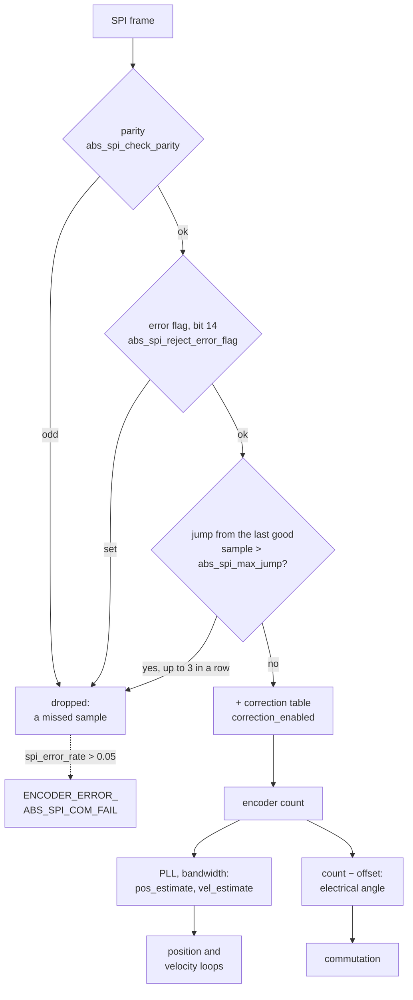
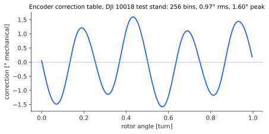
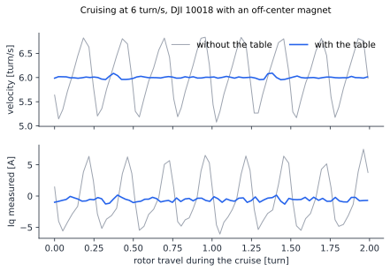

# Encoders

The Mini carries an AS5047 magnetic encoder that reads a diametric magnet on the motor's shaft over SPI, so the board sits on the motor's axis. This page covers setting it up, the frame checks this firmware adds, and the correction table that removes the angle error of an imperfectly placed magnet. Every setting named here is under `axis0.encoder` in the [property reference](reference.md).

## Setup

The onboard encoder in the 10018 example:

| Setting | Value | Meaning |
|---|---|---|
| `encoder.config.mode` | 257 (`SPI_ABS_AMS`) | AS5047 over SPI |
| `encoder.config.abs_spi_cs_gpio_pin` | 7 | The onboard encoder's chip select |
| `encoder.config.cpr` | 16384 | Counts per turn (14 bit) |
| `encoder.config.bandwidth` | 500 rad/s | The bandwidth of the PLL that estimates position and velocity ([Control](control.md#tuning)). The commutation angle comes from the encoder count, not from the PLL's position estimate, so this setting acts mainly on the position and velocity loops |
| `encoder.config.calib_range` | 0.05 | Offset calibration fails if the measured movement differs from the expected by more than 5 % (default 2 %) |

An absolute encoder knows its angle at power-up, so after one offset calibration the board can start straight into closed loop (as ODrive v0.5.6 does): save `encoder.config.pre_calibrated = True` with `axis0.config.startup_encoder_offset_calibration = False` and `startup_closed_loop_control = True` ([Getting started](getting-started.md#configure-and-calibrate)). The board then holds about 2.5 s after power-up, without a calibration sweep.

The offset calibration (`AXIS_STATE_ENCODER_OFFSET_CALIBRATION`) turns the rotor open loop over `calib_scan_distance` electrical radians each way (8 electrical turns by default: 0.38 turn on a 21-pole-pair motor), measures the direction and the offset between the encoder's zero and the rotor's electrical angle, and checks the encoder moved as far as expected.

**The magnet** sets how good the measurement can be. Center it on the shaft, keep it flat, and set the air gap to the AS5047 datasheet's range. An off-center magnet gives an angle error that repeats every turn: one measured mount had 1.34° at 4x per turn and 0.28° at 2x, the same over two days. The error leaks back-EMF into the d axis, and the current ripple grows with speed squared: without correction, that DJI 10018 at 24 V faulted with `MOTOR_ERROR_CURRENT_LIMIT_VIOLATION` at about 12 turn/s.

## From SPI frame to commutation

Each control period, the bottom-of-PWM interrupt starts one SPI read of the AS5047 (16-bit frame: 14-bit angle, error flag, parity or warning bit). The frame passes the [frame checks](#frame-checks), then the [correction table](#correction-table), before the control loop uses it:

## Frame checks

Every SPI frame from an AMS encoder carries an error flag (bit 14) and, on an AS5047P, an even-parity bit (bit 15). An AS5047U has no parity: bit 15 is a warning flag. A corrupted frame used as a real position becomes a false jump and a large current demand, so the firmware can drop bad frames. A dropped frame counts as a missed sample: when too many go missing, `encoder.spi_error_rate` rises above 0.05 and the encoder faults with `ENCODER_ERROR_ABS_SPI_COM_FAIL`.

| Setting | Default | Effect |
|---|---|---|
| `abs_spi_check_parity` | off | Drop frames with odd parity. On for an AS5047P, off for an AS5047U |
| `abs_spi_reject_error_flag` | off | Drop frames with the error flag. The flag stays set until the chip's error register is read, so one event drops frames until then |
| `abs_spi_max_jump` | 1024 counts (1/16 turn) | Drop a sample further than this from the last good one; 0 turns it off. It starts after 16 good samples, and a fourth sample in a row at the new position is accepted, so a real step can't lock the reading out |

The counters `spi_frame_count`, `spi_parity_error_count`, `spi_error_flag_count`, `spi_warning_flag_count` and `spi_jump_count` show what arrives. Makerbase's BOM lists an AS5047U, but the board checked behaves as an AS5047P: bit 15 was even parity in 600 of 600 frames, and with `abs_spi_check_parity` off, `spi_parity_error_count` stayed at 0 over millions of frames, which only a chip sending parity does. Check each board this way before turning the parity check on.

## Correction table

The correction table removes the encoder's per-angle error: 256 bins over one turn, added to the raw position before commutation and control (`encoder.config.correction_enabled`).

**Recording it** (motor moves): `python tools/calibrate.py --correction`, or `requested_state = AXIS_STATE_ENCODER_CORRECTION_CALIBRATION` (14). The board turns an open-loop current vector (`motor.config.calibration_current`) forward and back over `correction_scan_turns` mechanical turns (1 by default) and records the encoder's error in each bin. It needs a calibrated motor and a working encoder. Run the offset calibration again afterwards, then save. `correction_rms`, `correction_peak` and `correction_bins` report the result (`correction_bins` = 256 means both directions covered every bin).

**Harmonics:** the calibration keeps harmonics 1 to `correction_max_harmonic` (12 by default) of the error per turn. The raw bins also record cogging, which pulls the rotor ahead of and behind the field at the motor's slot and magnet counts (36x and 42x per turn on the 10018). That isn't encoder error, and in the table it becomes a false commutation error of 4 to 9 electrical degrees, which makes the motor run worse. A magnet placement error is low order (1x, 2x, 4x, 8x).

**The effect**, on the 10018 at a 6 turn/s cruise:

The 4x-per-turn ripple falls 94 % in velocity and 92 % in current, peak current while cruising falls from 7.5 to 1.4 A, and the motor runs cleanly up to 21 turn/s at 24 V (its voltage ceiling is 23.4 turn/s).

**Managing tables:** `python tools/correction_table.py` shows the board's table and its harmonics, saves it to JSON (`--save-json`), restores one (`--load-json`), or smooths it to fewer harmonics (`--smooth H`). Writes are RAM only until saved.

A table corrects only what repeats with angle. It can't fix a magnet that shifts, noise and SPI glitches, or an air gap that changes with load or temperature. Each motor and mount needs its own table, recorded again after the magnet is moved.

## Wiring noise

The onboard encoder needs no wiring. For an external SPI encoder on J4 (pinout in [Hardware](hardware.md#header-pinouts), from the schematic; unchecked on a board), with `abs_spi_cs_gpio_pin = 6`:

- Keep the encoder cable away from the motor phases, and keep it short.
- Twisted pairs with one wire of each pair on ground, or shielded cable, reduce pickup; avoid ribbon cable.
- A 20 to 50 Ω resistor in series with SCK, near the board, softens its edges.

## Other encoders

The firmware keeps ODrive v0.5.6's support for incremental (ABI), hall, sin/cos and other SPI encoders (CUI AMT23 and MagAlpha MA732). None of them is tested on the Mini; ODrive's [v0.5.6 encoder page](https://docs.odriverobotics.com/v/0.5.6/encoders.html) describes their setup, and [Hardware](hardware.md#gpios) lists the Mini's encoder pins.
