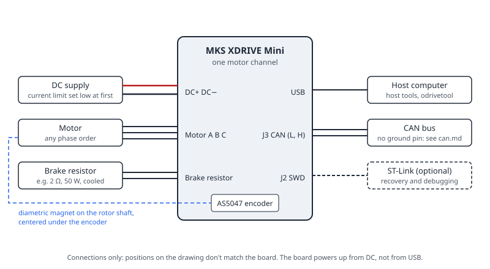
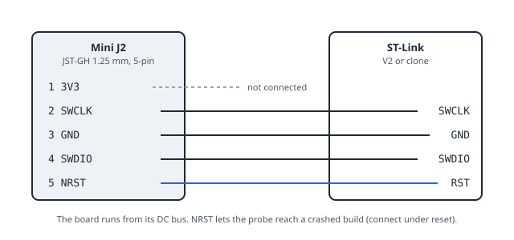

# Getting started

This page takes an MKS XDRIVE Mini from unpacked to holding position in closed loop, using the host tools in `tools/`. It assumes a motor with a diametric magnet on its shaft for the onboard encoder. The example settings are for a DJI 10018; the [settings section](#adapt-the-settings) says which values change for another motor.

> **Warning:** the Mini drives high-current motors from a supply of up to about 56 V. A wrong setting can spin the motor at full speed or pump the supply voltage up. Keep the supply's current limit low for the first power-up, keep `python tools/idle.py` ready (it puts the axis in IDLE: no torque), and keep hands clear of the rotor.

## What you need

- An MKS XDRIVE Mini, and a motor whose rotor carries a diametric magnet centered under the board's AS5047 encoder at the encoder's specified air gap (an off-center or tilted magnet shows up as a 4x-per-turn current ripple; the [encoder correction table](encoders.md) removes most of it).
- A DC supply with a current limit, and a brake resistor (the test stand uses a 2 Ω, 50 W resistor). Without a brake resistor, a hard stop pumps energy back into the supply.
- A USB cable to a host computer with Python 3.11 (tested on macOS).
- Optional: an ST-Link for recovery and debugging over SWD.

## Wire it



- **DC:** the supply to DC+ and DC−. The MCU runs off the DC bus, so the board appears on USB only while the supply is on.
- **Motor:** the three phases in any order; calibration measures the direction.
- **Brake resistor:** the 2-pin terminal. Mount it where it can shed heat.
- **USB** to the host. **J3** to a CAN bus, if used ([CAN](can.md)). **J2** to an ST-Link, if used:



## Install the host tools

From the repository root:

1. Install `uv` (on macOS: `brew install uv`; elsewhere: `pip install uv`).
2. `make venv` (creates `.venv` from `requirements.txt`; pyusb also needs libusb, on macOS: `brew install libusb`)
3. `source .venv/bin/activate`

On Linux, a user account reaches the board over USB only with a udev rule for the board (USB ID 1209:0d32) and for the STM32's bootloader (0483:df11), which `usb_flash.py` uses. These commands aren't tested here (the tested host is macOS):

```sh
sudo tee /etc/udev/rules.d/91-xdrive.rules <<'EOF'
SUBSYSTEM=="usb", ATTR{idVendor}=="1209", ATTR{idProduct}=="0d3[0-9]", MODE="0666", ENV{ID_MM_DEVICE_IGNORE}="1"
SUBSYSTEM=="usb", ATTR{idVendor}=="0483", ATTR{idProduct}=="df11", MODE="0666"
EOF
sudo udevadm control --reload-rules
sudo udevadm trigger
```

The tools write logs to `logs/` and flash backups to `backups/` under the working directory. Each tool's docstring gives its usage.

## Flash the firmware

A Mini from Makerbase runs their build of ODrive v0.5.1. Read [Migrating from Makerbase's firmware](migrating-from-stock.md) first: flashing resets the board's config, and the first backup is the only way back.

1. Download `xdrive-robotics-X.Y.Z.elf` from the releases page, or build it (`make`, see `docs/development.md`).
2. Motor moves (the dry run ends with a reboot): `python tools/usb_flash.py --elf xdrive-robotics-X.Y.Z.elf`. It enters the STM32's DFU bootloader, backs up the whole flash to `backups/`, compares and reboots without writing.
3. Motor moves (reboot): `python tools/usb_flash.py --elf xdrive-robotics-X.Y.Z.elf --write`.

Don't use `odrivetool dfu`: it fetches ODrive's own v3.6 firmware, which doesn't drive the Mini (it retries the missing second gate driver forever), and its DFU client is broken on Python 3.9 and later.

## Adapt the settings

`examples/dji-10018.json` holds the settings of a DJI 10018 on the test stand (gains, limits, encoder and supply settings; no calibration results). Copy it and change:

| Setting | 10018 value | What to set |
|---|---|---|
| `axis0.motor.config.pole_pairs` | 21 | Magnet count / 2 |
| `axis0.motor.config.torque_constant` | 0.1074 Nm/A | 8.27 / KV |
| `axis0.motor.config.current_lim` | 15 A | The motor's continuous current, or lower at first |
| `axis0.motor.config.calibration_current` | 5 A | A current the motor can carry at standstill for a few seconds |
| `axis0.motor.config.requested_current_range` | 20 A | Above `current_lim` plus `current_lim_margin`; at 20 A the current sense saturates at about 33.8 A |
| `axis0.controller.config.vel_limit` | 8 turn/s | Start low |
| `config.dc_bus_overvoltage_trip_level` | 36 V | A few volts above the supply, never near the board's 60 V parts |
| `config.brake_resistance`, `config.enable_brake_resistor` | 2 Ω, true | Your resistor |
| `axis0.encoder.config.abs_spi_check_parity` | true | True for an AS5047P (bit 15 is parity), false for an AS5047U |

The gains suit the 10018's unloaded rotor; [Control](control.md) covers tuning for a load.

## Configure and calibrate

1. `python tools/set_config.py --file <your settings>.json` (refuses unless the axis is IDLE, dumps the config first, writes, reads back).
2. `python tools/set_config.py --save axis0.config.startup_encoder_offset_calibration=false` (the board saves and reboots, which applies the SPI encoder mode).
3. Motor moves: `python tools/calibrate.py --motor --offset --correction`. It measures phase resistance and inductance, scans the encoder offset (8 electrical turns each way: 0.38 turn on a 21-pole-pair motor) and records the [correction table](encoders.md) (one turn each way), then prints the results.
4. Motor moves: `python tools/set_config.py --save axis0.encoder.config.pre_calibrated=true axis0.config.startup_closed_loop_control=true`. The board saves the calibration and reboots into closed loop, holding position, about 2.5 s after power-up from then on, without a calibration sweep.
5. `python tools/dump_board.py --compare <your settings>.json` lists every setting that differs and the board's errors.

## First moves

- Motor moves: `python tools/move_test.py --moves 1,2 --label first` runs out-and-back trap moves of 1 and 2 turns and logs them. It goes IDLE on any error, a following error over 0.25 turn or Ctrl-C.
- `python tools/idle.py` stops the motor.
- Every property is listed in the [property reference](reference.md); `odrivetool` reads and writes them interactively (`odrv0.axis0.encoder.pos_estimate`).

## Next

- [Safety and regen](safety-and-regen.md): limits, faults and what to set before a motor drives a load.
- [CAN](can.md): node IDs, wiring and the impedance command.
- [Troubleshooting](troubleshooting.md).
