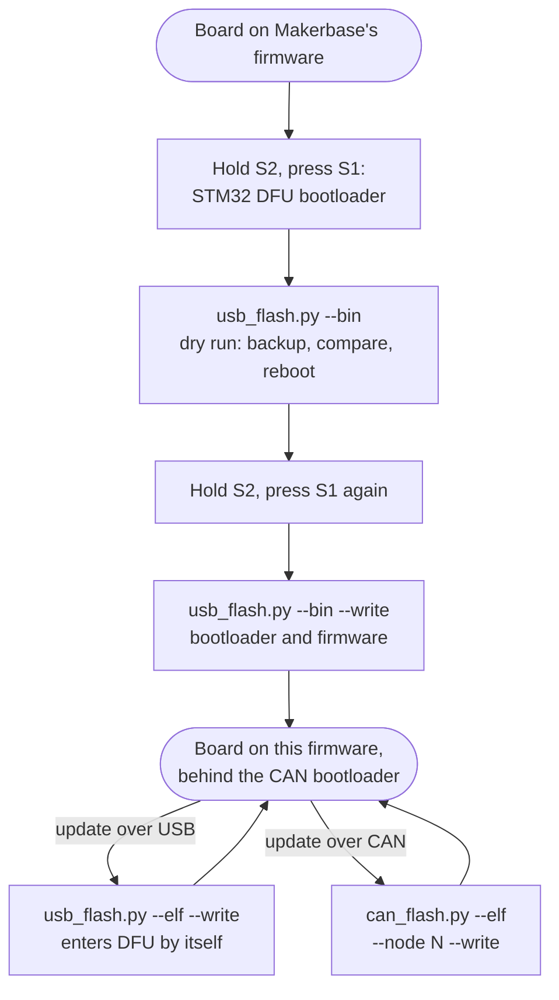

# Getting started

This page takes an MKS XDRIVE Mini from unpacked to holding position in closed loop, using the host tools in `tools/` ([Host tools](tools.md) lists them all). It assumes a motor with a diametric magnet on its shaft for the board's onboard encoder. The example settings are for a DJI 10018; [Adapt the settings](#adapt-the-settings) says which values change for another motor.

> **Warning:** the Mini drives high-current motors from a supply of up to about 56 V. A wrong setting can spin the motor at full speed or pump the supply voltage up. Keep the supply's current limit low for the first power-up, keep `python tools/idle.py` ready (it puts the axis in IDLE: no torque), and keep hands clear of the rotor. Steps marked "Motor moves" turn the rotor or reboot the board, which runs its startup sequence.

## What you need

- An MKS XDRIVE Mini, and a motor whose rotor carries a diametric magnet centered under the board's AS5047 encoder at the encoder's specified air gap. An off-center or tilted magnet shows up as a 4x-per-turn current ripple, which the [encoder correction table](encoders.md#correction-table) mostly removes.
- A DC supply with a current limit, and a brake resistor (the example settings assume 2 Ω, 50 W). Without a brake resistor, a hard stop pumps energy back into the supply.
- A USB cable to a host computer with Python 3.11 (tested on macOS) and [`uv`](https://docs.astral.sh/uv/).
- Optional: an ST-Link for recovery and debugging over SWD, and a USB-CAN adapter for [CAN](can.md).

## Wire it


- **DC:** the supply to DC+ and DC−. The MCU runs off the DC bus, so the board appears on USB only while the supply is on.
- **Motor:** the three phases in any order; calibration measures the direction.
- **Brake resistor:** the 2-pin terminal. Mount the resistor where it can shed heat.
- **USB** to the host. **J3** to a CAN bus, if used ([CAN](can.md#wiring)). **J2** to an ST-Link, if used:


[Hardware](hardware.md) has every connector's pinout.

## Install the host tools

From the repository root:

1. Install `uv` (on macOS: `brew install uv`; elsewhere: `pip install uv`).
2. `make venv` (creates `.venv` with Python 3.11 from `requirements.txt`; pyusb also needs libusb, on macOS: `brew install libusb`).
3. `source .venv/bin/activate`

On Linux, a user account reaches the board over USB only with a udev rule for the board (USB ID 1209:0d32) and for the STM32's bootloader (0483:df11), which `usb_flash.py` uses. These commands are untested (the tested host is macOS):

```sh
sudo tee /etc/udev/rules.d/91-xdrive.rules <<'EOF'
SUBSYSTEM=="usb", ATTR{idVendor}=="1209", ATTR{idProduct}=="0d3[0-9]", MODE="0666", ENV{ID_MM_DEVICE_IGNORE}="1"
SUBSYSTEM=="usb", ATTR{idVendor}=="0483", ATTR{idProduct}=="df11", MODE="0666"
EOF
sudo udevadm control --reload-rules
sudo udevadm trigger
```

Run the tools from the repository root. They write logs to `logs/` and flash backups to `backups/` under the working directory.

## Flash the firmware

A Mini from Makerbase runs their build of ODrive v0.5.1. Read [Migrating from Makerbase's firmware](migrating-from-stock.md) first: flashing resets the board's config, and the first flash backup is the only way back.

The firmware runs behind its own [CAN bootloader](bootloader.md), so a board's first flash writes both, from 0x08000000: `xdrive-robotics-X.Y.Z-with-bootloader.bin` from the [releases page](https://github.com/s11tomp/xdrive-robotics/releases), or `build/firmware-with-bootloader.bin` from a build ([Development](development.md#build)).

The first flash needs the buttons twice, because the dry run leaves the DFU bootloader; later updates need no buttons:



1. Put the board in the STM32's DFU bootloader: hold S2 while pressing S1 (reset). Makerbase's firmware can't be asked to do this, so the button is the way in. (A board already on this firmware doesn't need it: `usb_flash.py` sends it there itself.)
2. Motor moves (the dry run leaves the bootloader, so the board reboots): `python tools/usb_flash.py --bin xdrive-robotics-X.Y.Z-with-bootloader.bin`. It backs up the whole flash to `backups/`, compares and reboots without writing.
3. S2 and S1 again, as in step 1.
4. Motor moves (reboot): `python tools/usb_flash.py --bin xdrive-robotics-X.Y.Z-with-bootloader.bin --write`. It erases and writes only the sectors the image covers, reads the whole flash back and checks it, then starts the firmware.

Later updates write only the firmware, behind the bootloader: `python tools/usb_flash.py --elf xdrive-robotics-X.Y.Z.elf --write` over USB, or `can_flash.py` over CAN ([CAN bootloader](bootloader.md#updating-over-can)). [Host tools](tools.md#flashing) describes every flash tool's checks.

Don't use `odrivetool dfu`: it fetches ODrive's own v3.6 firmware, which doesn't drive the Mini (it retries the missing second gate driver forever), and its DFU client fails on Python 3.9 and later.

## Adapt the settings

`examples/dji-10018.json` holds the settings of a DJI 10018 with an unloaded rotor at 24 V (gains, limits, encoder and supply settings; no calibration results). Copy it and change:

| Setting | 10018 value | What to set |
|---|---|---|
| `axis0.motor.config.pole_pairs` | 21 | Magnet count / 2 |
| `axis0.motor.config.torque_constant` | 0.1074 Nm/A | 8.27 / KV |
| `axis0.motor.config.current_lim` | 15 A | The motor's continuous current, or lower at first |
| `axis0.motor.config.calibration_current` | 5 A | A current the motor can carry at standstill for a few seconds |
| `axis0.motor.config.requested_current_range` | 20 A | Above `current_lim` plus `current_lim_margin`; at 20 A the current sense saturates at about 33.8 A |
| `axis0.controller.config.vel_limit` | 8 turn/s | Start low |
| `config.dc_bus_overvoltage_trip_level` | 36 V | A few volts above the supply, never near the board's 60 V parts |
| `config.brake_resistance`, `config.enable_brake_resistor` | 2 Ω, true | Your resistor |
| `axis0.encoder.config.abs_spi_check_parity` | true | True for an AS5047P (bit 15 is parity), false for an AS5047U ([Encoders](encoders.md#frame-checks) shows how to tell) |

The gains suit the 10018's unloaded rotor; [Control](control.md#tuning) covers tuning for a load.

## Configure and calibrate

1. `python tools/set_config.py --file <your settings>.json` (refuses unless the axis is IDLE, dumps the config first, writes, reads back).
2. Motor moves (reboot): `python tools/set_config.py --save axis0.config.startup_encoder_offset_calibration=false`. The board saves and reboots, which applies the SPI encoder mode.
3. Motor moves: `python tools/calibrate.py --motor --offset --correction`. It measures phase resistance and inductance (and sets `motor.config.pre_calibrated`), scans the encoder offset (8 electrical turns each way: 0.38 turn on a 21-pole-pair motor) and records the [correction table](encoders.md#correction-table) (one turn each way, about 25 s), then prints the results. The results are in RAM until the next step saves them.
4. Motor moves (reboot): `python tools/set_config.py --save axis0.encoder.config.pre_calibrated=true axis0.config.startup_closed_loop_control=true`. The board saves the calibration and reboots into closed loop, holding position. From then on it holds about 2.5 s after power-up, without a calibration sweep: an absolute encoder knows its angle at boot.
5. `python tools/dump_board.py --compare <your settings>.json` lists every setting that differs and the board's errors.

## First moves

- Motor moves: `python tools/move_test.py --moves 1,2 --label first` runs out-and-back trapezoidal moves of 1 and 2 turns and logs them. It goes IDLE on any error, a following error over 0.25 turn, or Ctrl-C.
- `python tools/idle.py` stops the motor.
- The [Python library](python-library.md) reads and writes every property interactively; the [property reference](reference.md) lists them all.

## Next

- [Safety and regen](safety-and-regen.md): limits, faults and what to set before a motor drives a load.
- [CAN](can.md): node IDs, wiring and the impedance command.
- [Troubleshooting](troubleshooting.md).
