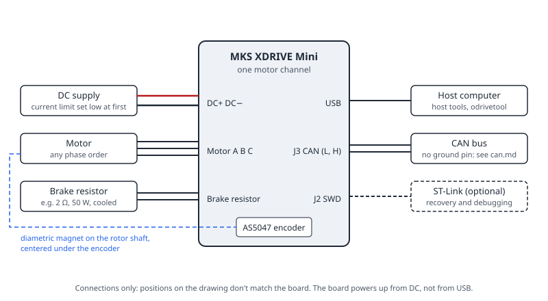

# Hardware

The MKS XDRIVE Mini is a single-motor clone of the ODrive v3.6: an STM32F405, one DRV8301 gate driver, 60 V FETs, low-side current shunts on phases B and C, an onboard AS5047 encoder and a brake half-bridge. It reports itself as an ODrive v3.6, 56 V variant (`hw_version_variant` = 56), so the firmware uses ODrive v3.6's pin assignments. This page covers the board's connectors, pins, sensing and timing, the ODrive features its GPIOs can carry, and the motor the firmware is tested with.

Each fact says where it comes from: **checked on a board**, or **from the schematic** (Makerbase's, in [makerbase-motor/MKS-ODrive](https://github.com/makerbase-motor/MKS-ODrive), folder `Hardware/MKS ODrive MINI`, which also holds the BOM).

## Connectors

| Connector | Pins | Use |
|---|---|---|
| Power and motor terminal | 5 positions, pluggable screw terminal | DC+ and DC− from the supply, and the three motor phases (checked on a board) |
| Brake resistor terminal | 2 | The brake resistor, driven by a half-bridge (two FETs and an LM5109B driver) |
| USB | | The host tools. The MCU runs off the DC bus, so the board appears on USB only while the supply is on (checked on a board) |
| J1 | 2, jumper | Fits the onboard 120 Ω CAN terminator (R18): only on the board at the end of the bus |
| J2 | 5, JST-GH 1.25 mm | SWD (checked on a board) |
| J3 | 2, JST-GH 1.25 mm | CAN, through an SN65HVD232 transceiver (3.3 V) |
| J4 | 6, JST-GH 1.25 mm | SPI, for an external SPI encoder |
| J5 | 5, JST-GH 1.25 mm | Incremental encoder (A, B, Z) |
| J6 | 6, JST-GH 1.25 mm | GPIO1 to GPIO4 |
| S1 | button | Reset |
| S2 | button | Pulls BOOT0 high (R30 pulls it down otherwise): held through a reset (S1), the board starts in the STM32's built-in DFU bootloader, whatever the flash holds |

### Header pinouts

| Pin | J2 SWD | J3 CAN | J4 SPI | J5 encoder | J6 GPIO |
|---|---|---|---|---|---|
| 1 | 3V3 | CAN_L | 3V3 | 5V | GND |
| 2 | SWCLK | CAN_H | GPIO6 (chip select) | Z (GPIO11) | 5V |
| 3 | GND | | SCK | B (GPIO10) | GPIO4 |
| 4 | SWDIO | | MISO | A (GPIO9) | GPIO3 |
| 5 | NRST | | MOSI | GND | GPIO2 |
| 6 | | | GND | | GPIO1 |

- J2 is checked on a board; the other headers come from the schematic. With the board powered, SWCLK reads about 0 V (a pull-down) and SWDIO about 3.3 V (a pull-up), which tells the two apart. GND, SWCLK and SWDIO suffice to read the flash; NRST wired to the probe's RST lets the probe connect under reset to a crashed build.
- J3 has no ground pin: see [CAN](can.md#wiring).
- J4 shares SPI3 with the onboard encoder and the gate driver. An external encoder on it needs its own chip select: GPIO6.
- J5's A, B and Z lines have 3.3 kΩ pull-ups to 3.3 V; the connector supplies 5 V to the encoder.

## GPIOs

The firmware numbers GPIOs as ODrive v3.6 does. On the Mini (MCU pins and connections from the schematic; default modes from the firmware):

| GPIO | MCU pin | Reaches | Input filter | Default mode | Other modes |
|---|---|---|---|---|---|
| 1 | PA0 | J6 pin 6 | 3.3 kΩ, 100 pF | `UART_A` (TX) | digital, analog in, PWM input, mechanical brake |
| 2 | PA1 | J6 pin 5 | 3.3 kΩ, 100 pF | `UART_A` (RX) | digital, analog in, PWM input, mechanical brake |
| 3 | PA2 | J6 pin 4 | none | `ANALOG_IN` | digital, `UART_B` (TX), PWM input, mechanical brake |
| 4 | PA3 | J6 pin 3 | none | `ANALOG_IN` | digital, `UART_B` (RX), PWM input, mechanical brake |
| 5 | PC4 | not connected | | `ANALOG_IN` | |
| 6 | PB2 | J4 pin 2 | 3.3 kΩ, 100 pF | `DIGITAL` | chip select for an external SPI encoder, digital |
| 7 | PA15 | the onboard AS5047's chip select | 3.3 kΩ, 100 pF | `DIGITAL` | reserved: `encoder.config.abs_spi_cs_gpio_pin = 7` |
| 8 | PB3 | not connected | | `DIGITAL` | |
| 9, 10 | PB4, PB5 | J5 A, B | 3.3 kΩ pull-up | `ENC0` | digital |
| 11 | PC9 | J5 Z | 3.3 kΩ pull-up | `DIGITAL_PULL_DOWN` | encoder index |
| 12 to 14 | PB6, PB7, PC15 | not connected (the second encoder on dual-motor boards) | | `DIGITAL_PULL_DOWN` | |
| 15, 16 | PB8, PB9 | the CAN transceiver | | `CAN_A` | |

- `odrv0.config.gpioN_mode` sets a GPIO's mode (values in `GpioMode` in the [property reference](reference.md#gpiomode)); a change takes effect after a save and reboot. A feature works only on a GPIO set to its mode, and needs its own enable as well (`config.enable_uart_a`, for example).
- "Digital" covers step and direction inputs, enable inputs, endstops and encoder chip selects.
- Drive the GPIOs with 3.3 V logic: whether the Mini's GPIOs tolerate 5 V is unchecked. They share the board's ground, the DC bus negative: see [ground loops](safety-and-regen.md#ground-loops).
- The second motor's gate drive and chip select pins (PA7, PB0, PB1, PC6 to PC8, PC14), current sense inputs (PC2, PC3), encoder index (PC15) and thermistor appear in the schematic only as labels at the MCU, while every first-motor net also reaches the gate driver or its sensors. The firmware puts the gate drive and chip select pins in analog mode.

## Inherited ODrive features

The firmware keeps the rest of ODrive v0.5.6's interfaces unchanged. None of them is tested on the Mini. ODrive's v0.5.6 documentation describes them; on the Mini, ignore everything about `axis1` and the second motor, and use these pins:

| Feature | ODrive v0.5.6 page | Pins on the Mini |
|---|---|---|
| Step and direction input | [Step & Direction](https://docs.odriverobotics.com/v/0.5.6/step-direction.html) | Any digital GPIO on J6 or J4; needs circular setpoints ([Migrating](migrating-from-stock.md#behavior-that-changes)) |
| RC PWM input | [RC PWM input](https://docs.odriverobotics.com/v/0.5.6/rc-pwm.html) | GPIO1 to GPIO4 (J6) |
| UART and the ASCII protocol | [UART Interface](https://docs.odriverobotics.com/v/0.5.6/uart.html), [ASCII Protocol](https://docs.odriverobotics.com/v/0.5.6/ascii-protocol.html) | UART_A on GPIO1 (TX) and GPIO2 (RX), the default; UART_B on GPIO3 and GPIO4 |
| Endstops and homing | [Endstops and Homing](https://docs.odriverobotics.com/v/0.5.6/endstops.html) | Any digital GPIO on J6 or J4 |
| Analog input | [Analog Input](https://docs.odriverobotics.com/v/0.5.6/analog-input.html) | GPIO1 to GPIO4 (J6) |
| Motor thermistor | [Thermistors](https://docs.odriverobotics.com/v/0.5.6/thermistors.html) | An analog GPIO on J6; the FET thermistor is onboard |
| Incremental, hall, sin/cos and other SPI encoders | [Encoders](https://docs.odriverobotics.com/v/0.5.6/encoders.html) | J5 (A, B, Z) or J4 (SPI, chip select GPIO6) |

## Sensing

- **Phase currents:** two low-side shunts (0.5 mΩ, phases B and C) through the DRV8301's amplifiers, sampled by ADC2 and ADC3 at each update of TIM1, the PWM timer. Phase A is computed as −(B + C). `motor.config.requested_current_range` sets the amplifier gain: at 20 A, the measurement saturates at about 33.8 A.
- **Bus voltage:** ADC1, sampled with the phase currents.
- **FET temperature:** an onboard thermistor (`motor.fet_thermistor`).

## Timing

PWM runs at 24 kHz, center-aligned on TIM1 (3500 clocks up and 3500 down at 168 MHz). TIM1's repetition counter makes an update event every 1.5 PWM periods, alternately at the bottom and the top of the count, 62.5 µs apart, and each event triggers the ADCs:

- **Bottom event** (8 kHz, the control rate): the low-side FETs conduct, so ADC2 and ADC3 read the phase currents and ADC1 the bus voltage. ADC1's end-of-conversion interrupt starts the encoder's SPI read and the control loop.
- **Top event**: the high-side FETs conduct and the shunts carry no current, so the sample calibrates the current amplifiers' offsets. The control loop waits for it, then writes the new duty cycles, which take effect at the next bottom event. A loop still running at that event disarms the motor (`MOTOR_ERROR_CONTROL_DEADLINE_MISSED`).
- The loop is busy about 73 µs of the 125 µs period, the wait included (measured with `tools/profile_loop.py`).
- **Brake PWM** (TIM2, 16 kHz): every TIM1 update event restarts its count, so its switching edges stay at least 1.1 µs away from each current sample.

## Flash and the STM32 bootloader

- **Flash:** 1 MB in 12 sectors: sectors 0 to 3 are 16 KB, sector 4 is 64 KB, sectors 5 to 11 are 128 KB. [CAN bootloader](bootloader.md#flash-layout) shows what the firmware keeps where; the config lives in sectors 10 and 11, so flashing only an image's sectors keeps it (checked on a board).
- **Protection:** the board checked came with read protection level 0 and no write-protected sectors. The flash tools never write the option bytes that set them.
- **Built-in DFU bootloader** (checked on a board): USB ID 0483:df11, with the same USB serial number as the firmware, so a board is found by serial in either mode. Alternate setting 0 is the internal flash (`04*016Kg,01*064Kg,07*128Kg`), 1 the option bytes, 2 the OTP memory, 3 the device features. Its DFU functional descriptor (transfer size 2048 bytes) follows alternate setting 3, not 0. Flash reads run at about 319 KiB/s. `tools/usb_flash.py` has its own DfuSe client, because the one in ODrive's Python package (`odrive.dfuse`) fails on Python 3.9 and later.
- **Entering it is safe on the Mini** (from the schematic): the STM32's bootloader pulls up PB10 and PB11, which are the brake half-bridge's inputs (AUX_L and AUX_H). 3.3 kΩ pull-downs (R24 on AUX_L, R21 on AUX_H) hold them near 0.25 V, as on ODrive v3.5 and later. Without them both brake FETs would turn on and short the bus.
- **Debug probes:** `st-info` and `st-flash` halt the core when they connect, which freezes the PWM on the windings; don't use them on a running board. OpenOCD with `reset_config none` reads without halting (`tools/swd_backup.py`).

## Tested motor: DJI 10018

The firmware is tested with a DJI 10018 on a bench stand at 24 V, with no load on the rotor. `examples/dji-10018.json` holds its settings.

- 77 KV, 42 magnets (`pole_pairs = 21`), 36 slots. Torque constant 8.27 / 77 ≈ 0.1074 Nm/A; ODrive's default of 0.04 makes every torque setting act 2.7 times stronger in amps.
- Cogging of about 0.09 Nm, at 36 and 42 times per turn.
- At 24 V, its voltage ceiling is about 23.4 turn/s (measured); faster needs a higher bus voltage.
- It is a propeller-cooled drone motor. Without airflow, copper loss is 1.5 × R × I²: about 8 W at 10 A and 19 W at 15 A. Give the motor and the brake resistor somewhere to shed heat.

## Other firmware for the Mini

- Makerbase's stock firmware and schematic: [makerbase-motor/MKS-ODrive](https://github.com/makerbase-motor/MKS-ODrive) (folder `MKS ODrive MINI`). [Migrating from Makerbase's firmware](migrating-from-stock.md) describes how it differs.
- A setup and tuning guide for the Mini on its stock firmware: [justlovescience/MKS-XDRIVE-MINI](https://github.com/justlovescience/MKS-XDRIVE-MINI).
- SimpleFOC firmware for the Mini: [simplefoc/mks_xdrive_mini_firmware](https://github.com/simplefoc/mks_xdrive_mini_firmware).
