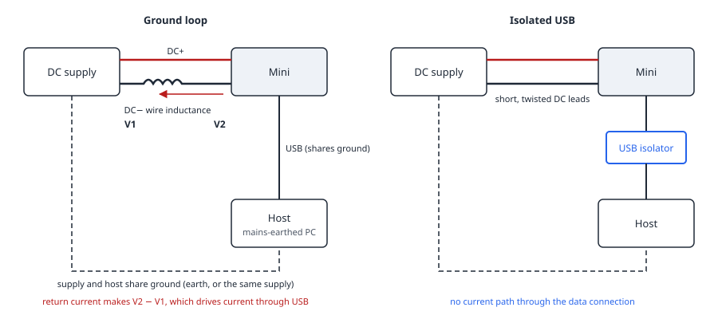

# Safety and regen

This page covers what stops a motor when something goes wrong, and where the energy goes when a motor brakes. The faults and regen limits this firmware adds are off by default, except the watchdog's decelerate-and-hold action, so a board behaves like ODrive v0.5.6 until they are set. Set them before a motor drives a load.

Every setting below is in the [property reference](reference.md) with its unit. Values quoted as "on the bench" come from `safety_test.py` and `regen_test.py` on a DJI 10018 with an unloaded rotor at 24 V.

## Faults

| Fault | Setting | What trips it | What happens |
|---|---|---|---|
| Watchdog | `axis0.config.enable_watchdog`, `watchdog_timeout` | No `watchdog_feed()` (or CAN command) for `watchdog_timeout` seconds | `watchdog_action` (below) |
| Soft position limits | `axis0.controller.config.pos_min`, `pos_max`, `pos_limit_margin` | Position beyond a limit by more than the margin, in closed loop, or entering closed loop outside the limits | `CONTROLLER_ERROR_POS_LIMIT_VIOLATION`; the axis disarms |
| Position following error | `axis0.controller.config.max_pos_error` | \|position setpoint − position\| above it, while position is controlled | `CONTROLLER_ERROR_POS_FOLLOWING_ERROR`; torque goes to 0 at once and the axis disarms |
| Velocity following error | `axis0.controller.config.max_vel_error` | \|velocity setpoint − velocity\| above it, while velocity is controlled | `CONTROLLER_ERROR_VEL_FOLLOWING_ERROR`; same |
| Current limit | `axis0.motor.config.current_lim`, `current_lim_margin` | Measured current above the limit plus the margin | `MOTOR_ERROR_CURRENT_LIMIT_VIOLATION`; the axis disarms |
| Bus overvoltage | `config.dc_bus_overvoltage_trip_level` | Bus voltage above it | `ODRIVE_ERROR_DC_BUS_OVER_VOLTAGE`; every motor disarms |
| Bus current | `config.dc_max_positive_current`, `dc_max_negative_current` | Bus current outside the range (regen beyond what the brake resistor absorbs, for example) | `ODRIVE_ERROR_DC_BUS_OVER_CURRENT` or `DC_BUS_OVER_REGEN_CURRENT`; every motor disarms |

"Disarms" means the axis sets `AXIS_ERROR_CONTROLLER_FAILED` or a motor error and goes IDLE: the gate driver stops switching and the motor turns freely. `python xdrive/tools/dump_board.py` decodes the errors; `odrv0.clear_errors()` clears them.

The position limits act before they fault: trap-trajectory targets and the position setpoint are clamped to [`pos_min`, `pos_max`]. On the bench, a trap move to +5 turns with the limit at +2 stopped 0.0000 turn from it. Velocity control stops 0.003 to 0.005 turn past a limit and can move back. Torque control isn't clamped, so it runs past the limit until the margin trips the fault.

In [impedance control](control.md), each following-error check covers only a term its gain controls: the position check needs `input_kp` > 0, the velocity check `input_kd` > 0.

### Watchdog: decelerate and hold

`axis0.config.watchdog_action` chooses what an expired watchdog does in closed loop:

- `DECEL_HOLD` (the default): the controller ramps to a stop at `watchdog_decel` (turn/s²), holds that position and ignores new inputs. `controller.timeout_active` is true meanwhile, and torque is capped at `watchdog_torque_lim` (infinity: the normal limit). To resume: feed the watchdog, then `clear_errors()`; the inputs are set to the hold position, so nothing jumps.
- `DISARM`: ODrive's behavior. `AXIS_ERROR_WATCHDOG_TIMER_EXPIRED` and the motor turns freely, which drops a joint holding a load.

On the bench, with a 0.2 s timeout: the hold started 0.197 s after the last feed, the stop from 5 turn/s at 10 turn/s² took 0.500 s over 1.251 turns (0.501 s and 1.254 turns predicted), and the hold stayed within 0.0006 turn.

## Regen: where braking energy goes

A motor that brakes works as a generator and pushes current back into the bus. Most bench supplies can't take current back, so the bus voltage climbs until something absorbs the energy or the overvoltage trip disarms the motor. Four mechanisms absorb it:

1. **The supply**, up to `config.max_regen_current` (0 for a supply that can't sink current).
2. **The brake resistor** (`config.enable_brake_resistor`, which takes effect after a save and reboot, and `brake_resistance`). The firmware switches it to burn the regen current beyond `max_regen_current`.
3. **Flux braking** (`axis0.motor.config.flux_brake_start_voltage`, `flux_brake_gain`): above the start voltage the motor adds d-axis current, Id = −gain × (vbus − start), up to the current limit, which burns energy in the windings (1.5 × R × Id²) without making torque. At most about 19 W on the 10018 at 15 A. Set the start a little above the supply voltage and below the overvoltage trip.
4. **Bus current soft limits** (`axis0.motor.config.I_bus_soft_min`, `I_bus_soft_max`): each control period the firmware predicts the bus current from the motor's state and limits the torque current to keep it in range. On the regen side (`I_bus_soft_min`, e.g. 0) it first adds d-axis current to burn the excess, and cuts braking torque only when full current can't absorb it; the controller stops integrating meanwhile, so it doesn't wind up. `I_bus_soft_max` caps a board's draw from a shared supply.

On the bench, with the brake resistor off, a 120 turn/s² stop from 10 turn/s:

| Setting | Bus rise | Mean bus current while stopping |
|---|---|---|
| No limits | 3.87 V | −0.240 A |
| Flux braking from 0.5 V above idle, 10 A/V | 1.85 V | |
| `I_bus_soft_min = 0` | 0.32 V | −0.043 A |

With `I_bus_soft_min = 0` the stop took 0.071 s instead of 0.072 s and ended 0.0006 turn from target. `I_bus_soft_max = 0.3` A held the mean draw while accelerating to 0.295 A (0.678 A uncapped).

**Setting it up:**

- Set `config.dc_bus_overvoltage_trip_level` a few volts above the supply voltage, never near the board's 60 V parts.
- Use a brake resistor if the supply can't sink current, and give it somewhere to shed heat.
- In a multi-joint machine on one supply, the joints' regen and draw add up on the shared bus: `I_bus_soft_min` and `I_bus_soft_max` per board keep each one inside a budget.

## Ground loops

The Mini's logic ground is the DC bus negative, so anything wired to it shares the motor's return path. When a host is grounded somewhere else as well (a mains-earthed PC on USB, or a controller powered from the same supply), the motor current through the DC− wire's inductance and resistance makes the board's ground move against the host's, and that difference drives current through the USB ground and the signal pins:

- Keep the DC leads short and twisted together: less loop area, less inductance. This reduces the problem but doesn't remove it.
- Isolate the data connection: a USB isolator for USB, a digital isolator for UART, step/direction or PWM (check that it is fast enough for the signal).
- If isolation isn't possible, 3.3 to 10 kΩ series resistors at each receiving pin limit the injected current; signals can still glitch.
- CAN on J3 has no ground pin, so a CAN cable adds no ground path of its own; the CAN adapter's ground goes to the bus negative at one point ([CAN](can.md)).
